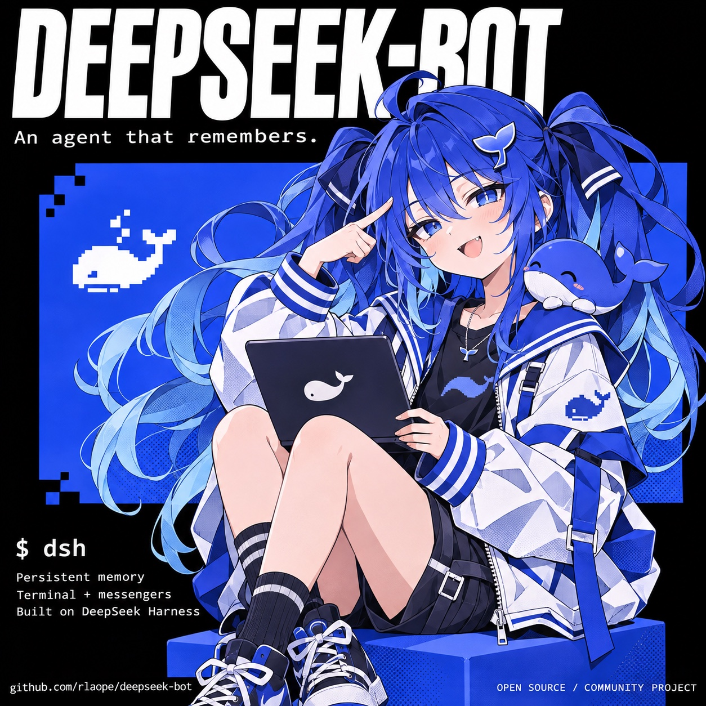
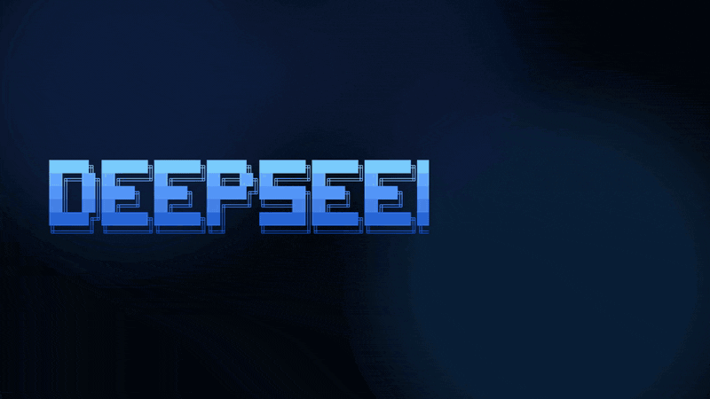

<div align="center">

<br>


<br>
<br>



<br>
<br>

**The agentic memory &amp; gateway for DeepSeek Harness. Install once, then just type `dsh`.**

[](https://github.com/rlaope/deepseek-bot/actions/workflows/ci.yml)
[](https://github.com/rlaope/deepseek-bot/stargazers)
[](docs/setup.md)
[](LICENSE)

**deepseek-bot** is a plugin for DeepSeek Harness.<br>
One always-on agent that remembers across conversations, in your terminal, Slack, Discord and Telegram.<br>
Its commands run in a sandbox, and anything destructive waits for a yes in the conversation.

</div>

## Install

```sh
curl -fsSL https://raw.githubusercontent.com/rlaope/deepseek-bot/master/install.sh | bash
dsh
```

[Messengers, the model provider and other options →](docs/setup.md)

<br>

## What you get

- **An agent in your terminal.**<br>
  `dsh` is a fullscreen terminal: answers stream in, tool calls show with their diffs.<br>
  It writes docx, xlsx and pptx, reads links with a headless browser, looks at images, and uses MCP tools.

- **Memory that survives.**<br>
  Every conversation is a durable session that survives restarts.<br>
  A persona, what it records about you and the work (`USER.md`, `MEMORY.md`, `memory/`), and a recall index<br>
  over past conversations come into each turn. Recall stays inside its own channel; not found is an answer.

- **Where people already talk.**<br>
  Slack, Discord and Telegram: mention it and it answers in the thread, 👀 then progress then the end mark.<br>
  `stop` ends a turn, `usage` shows tokens, `be quiet` mutes it with a 🫡 until it is named again.

- **Approvals in the conversation.**<br>
  A command that deletes or overwrites waits for the person who asked: Allow or Deny, in place.

- **Contained.**<br>
  Commands run under a Seatbelt sandbox that writes only its own workspace and cannot read tokens or credentials.<br>
  Text that tries to give it orders is flagged before the model sees it.

- **DeepSeek's own API by default.**<br>
  A key the harness already has is used as it is. OpenGateway or another OpenAI-compatible endpoint is an option.

<br>

## dsh

**Just type `dsh`, and the agent remembers.**

A real session: it reads a file, saves a fact, recalls it in a new conversation, and asks before deleting.<br>
<sub>Recorded on the optional OpenGateway route; DeepSeek's own API is the default.</sub>

<p align="center">
  
</p>

> [!TIP]
> Sponsored by [OpenGateway](https://opengateway.ai/), an OpenAI-compatible gateway that puts many model providers behind one API.
> An option, never a requirement.

<br>

## Others

[Setup](docs/setup.md) · [How it works](docs/how-it-works.md) · [Limitations](docs/limitations.md) · [Specification](SPEC.md) · [Plan](PLAN.md) · [Changelog](CHANGELOG.md)

<details>
<summary><b>Install options</b></summary>

It needs macOS with Node.js 22+, the DeepSeek Harness app and a DeepSeek API key; none is asked for if the
harness already has one. When the app is missing, the installer offers to download it from DeepSeek's own server,
checked against the build's published hash. Running the line again updates; so does `dsh update`.

```sh
dsh gateway setup      # connect Slack, Telegram or Discord: ↑↓ and Enter
dsh gateway status     # is it up, and where it found its key
```

Without a terminal: [installing without a terminal](docs/setup.md#installing-without-a-terminal).

</details>

<details>
<summary><b>Messengers</b></summary>

| Messenger | Verified |
| --- | --- |
| Slack | used live |
| Discord | against mocked APIs only |
| Telegram | against mocked APIs only |

On Telegram and Discord anyone who finds the bot can message it: list who may with
`dsh gateway setup telegram --users <your id>`.

</details>

<details>
<summary><b>What's verified</b></summary>

The unit suites run in CI against fakes; scenarios against a real model run by hand, or daily once
`service/install-scenarios.sh` schedules them; Slack and the terminal are in live use.
What is not verified is listed item by item in [PLAN.md](PLAN.md#unverified).

- macOS only: on Windows the terminal runs by hand, but the installer, services and sandbox are not ported.
- The sandbox is a policy boundary, not a separate OS user; an MCP server runs outside it, so add only ones you trust.
- DeepSeek Harness is a release candidate and this project leans on its internals: pin your version.

</details>

<details>
<summary><b>For contributors and agents</b></summary>

[Working rules](AGENTS.md) · [Vocabulary](CONTEXT.md)

</details>

## License

[MIT](LICENSE). deepseek-bot is an independent project, not affiliated with or endorsed by DeepSeek.
The DeepSeek name and logo belong to their owner.
