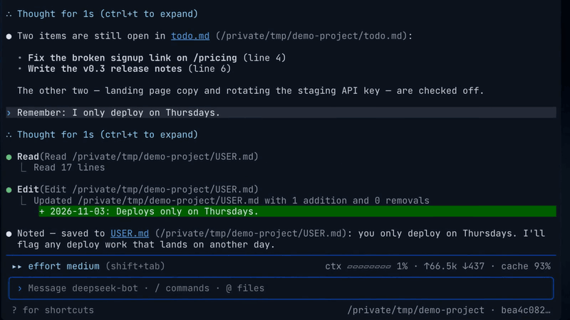
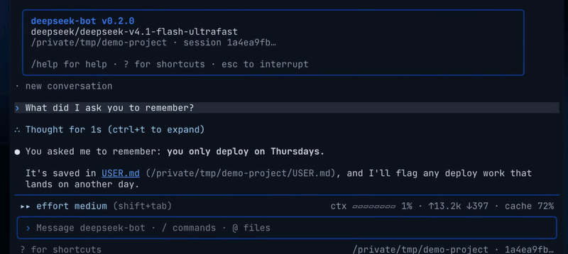
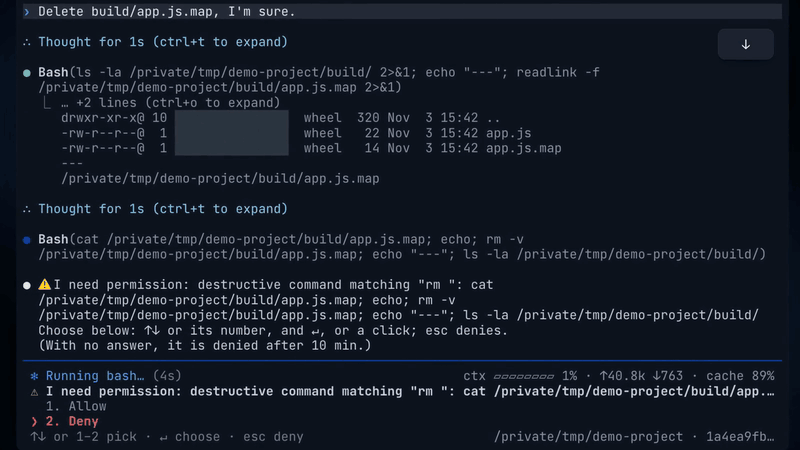

<p align="center">
  
</p>

<h1 align="center">deepseek-bot</h1>

<p align="center">
  <strong>The agentic memory &amp; gateway for DeepSeek Harness.</strong><br>
  <em>One always-on agent that remembers, in your terminal, Slack, Discord and Telegram.</em>
</p>

<p align="center">
  <a href="https://github.com/rlaope/deepseek-bot/actions/workflows/ci.yml"></a>
  
  
</p>

<p align="center">
  
  <br><sub>A real <code>dsh</code> session, waits sped up. Recorded on the optional OpenGateway route (the model id in the window); DeepSeek's own API is the default.</sub>
</p>

> **Sponsor.** [](https://opengateway.ai/) **[OpenGateway](https://opengateway.ai/)**, an OpenAI-compatible gateway that puts many model providers behind one API, backs deepseek-bot, a personal side project. Thank you.

## Quick Start

```bash
curl -fsSL https://raw.githubusercontent.com/rlaope/deepseek-bot/master/install.sh | bash
dsh                    # talk to it in the terminal
dsh gateway setup      # connect Slack, Telegram or Discord: ↑↓ and Enter
```

It needs macOS, Node.js 22+, the DeepSeek Harness app (the installer offers to download it from DeepSeek's own
server) and a DeepSeek API key, not asked for when the harness already has one. DeepSeek's own API is the default
and needs nothing else; OpenGateway or another OpenAI-compatible endpoint is an option the installer offers.
Running the line again updates; so does `dsh update`.

Or paste this into your AI agent:

```text
Install deepseek-bot on this Mac without a terminal prompt, following
https://github.com/rlaope/deepseek-bot/blob/master/docs/setup.md#installing-without-a-terminal
Check, by name only and without printing any value, whether ~/.dsh/.credentials.yaml (names under
refs:) or ~/.dsh/.env already has a DeepSeek key. If neither does, ask me for it and add a
DEEPSEEK_API_KEY= line to ~/.dsh/.env (create it with mode 600 and keep its other lines), without
printing it. Then run
curl -fsSL https://raw.githubusercontent.com/rlaope/deepseek-bot/master/install.sh | DEEPBOT_INSTALL_HARNESS=1 bash
and show me the output of `~/.local/bin/dsh gateway status`.
```

## What you get

### 01 · An agent in your terminal

`dsh` is a fullscreen terminal for the agent: answers stream in, tool calls show with their diffs, and approvals
and questions are answered in place. In a turn it can also write a docx, xlsx or pptx, read a link, look at an
image (with a model that accepts one) and use the tools of an MCP server you add.

<p align="center"></p>

### 02 · It remembers

Every conversation is a durable session that survives restarts. Its persona (`SOUL.md`) and what it records about
you and the work (`USER.md`, `MEMORY.md`, `memory/`) come into each turn, and passages from earlier conversations are
recalled from the same channel only, so a private conversation never surfaces in a public one. Not found is an
answer: asked about something never said, it says so rather than guessing.

<p align="center"></p>

### 03 · Where people already talk

Mention it in a Slack, Discord or Telegram channel, or message it directly, and it answers in the thread; the
message that asked shows 👀, then its progress, then the end. Plain words steer it, in English, Korean or
Chinese: `stop` ends the turn, `usage` shows the thread's tokens, `be quiet` mutes it with a 🫡 until it is named
again. Slack is used live; Discord and Telegram are tested against mocked APIs only.

### 04 · Contained

Its commands run under a Seatbelt sandbox that writes only its own workspace and cannot read the deployment's
tokens or your credential files. A command that deletes or overwrites waits for the person who asked: Allow or
Deny, in the terminal or as buttons in the thread. Text that tries to give it orders is flagged before the model
sees it. On Telegram and Discord anyone who finds the bot can message it: list who may with
`dsh gateway setup telegram --users <your id>`.

<p align="center"></p>

## What's verified

The unit suites run in CI against fakes; scenarios against a real model run by hand, or daily once
`service/install-scenarios.sh` schedules them; Slack and the
terminal are in live use. What is not verified is listed item by item in [PLAN.md](PLAN.md#unverified). In short:

- macOS only: on Windows the terminal runs by hand, but the installer, services and sandbox are not ported.
- The sandbox is a policy boundary, not a separate OS user; an MCP server runs outside it, so add only ones you trust.
- DeepSeek Harness is a release candidate and this project leans on its internals: pin your version.

## Documentation

- [Setup and operations](docs/setup.md): messengers, the model provider, MCP servers, the agent's network, the services
- [How it works](docs/how-it-works.md): memory layers, recall, approvals, the sandbox, and the evidence behind each claim
- [Limitations](docs/limitations.md) · [Specification](SPEC.md) · [Plan](PLAN.md) · [Changelog](CHANGELOG.md)
- For contributors and agents: [working rules](AGENTS.md) · [vocabulary](CONTEXT.md)

## License

[MIT](LICENSE). deepseek-bot is an independent project, not affiliated with or endorsed by DeepSeek.
The whale and the wordmark are the DeepSeek logo's; the DeepSeek name and logo belong to their owner.
