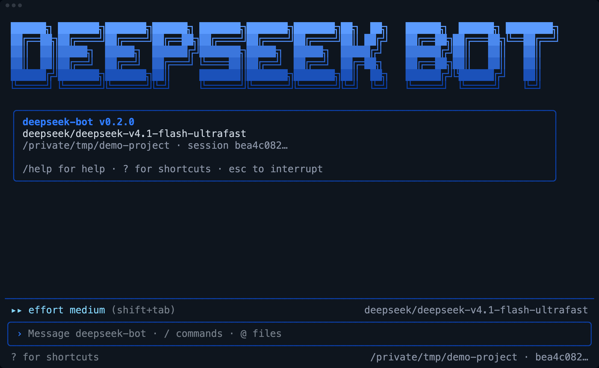
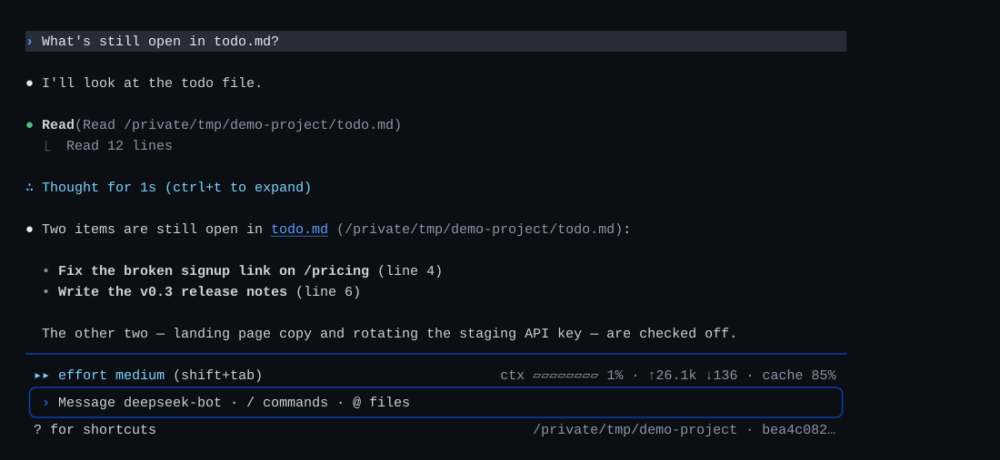
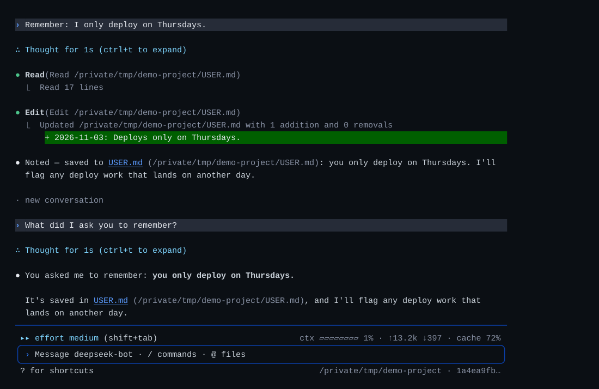
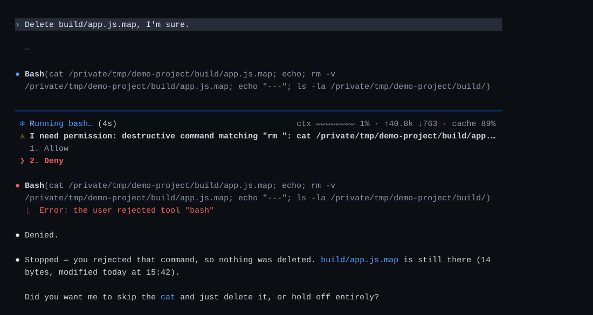
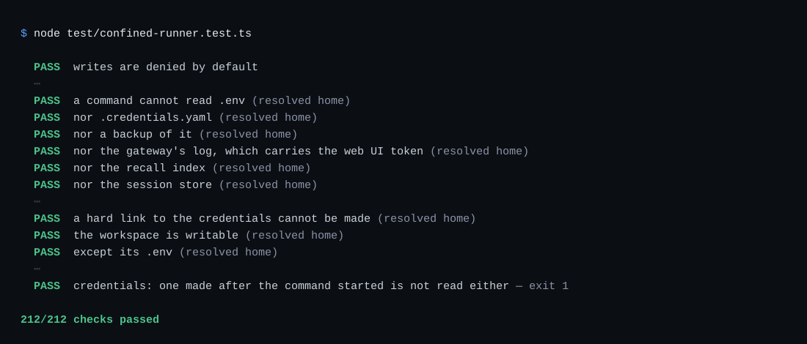
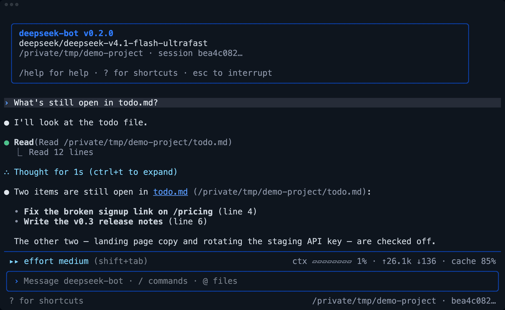
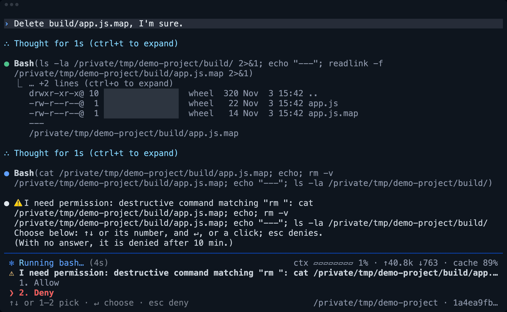

<p align="center">
  
</p>

# deepseek-bot

<p align="center">
  <a href="https://github.com/rlaope/deepseek-bot"></a>
  <a href="https://github.com/rlaope/deepseek-bot/actions/workflows/ci.yml"></a>
  <a href="LICENSE"></a>
  
  
  <a href="https://github.com/rlaope/deepseek-bot"></a>
</p>

<p align="center">
  
</p>

<p align="center">
  <strong>The agentic memory &amp; gateway for DeepSeek Harness.</strong>
  <br>
  <em>One always-on agent that remembers, in your terminal, Slack, Discord and Telegram.</em>
</p>

<p align="center">
  <strong>deepseek-bot</strong> keeps one DeepSeek agent running on your Mac. You talk to it in
  <code>dsh</code>, a fullscreen terminal, or mention it where your team already talks. Every
  conversation is a durable session, what it learns about you is written where you can read it,
  and anything that deletes or overwrites waits for the person who asked.
  <br><br>
  DeepSeek's own API is the default and needs nothing else. OpenGateway or another
  OpenAI-compatible endpoint is an option the installer offers.
</p>

<p align="center">
  <a href="docs/setup.md">Setup</a> ·
  <a href="docs/how-it-works.md">How it works</a> ·
  <a href="docs/limitations.md">Limitations</a> ·
  <a href="SPEC.md">Specification</a> ·
  <a href="PLAN.md">Plan</a> ·
  <a href="CHANGELOG.md">Changelog</a>
</p>

> [!NOTE]
> `dsh` opens on the deepseek-bot mark and a welcome box: the version, the model, the folder and the
> session. Every terminal image on this page is real output; the `dsh` ones are rendered from a recorded session.
>
> <p align="center">
>   
> </p>

> [!TIP]
> <table>
>   <tr>
>     <td width="124"><a href="https://github.com/rlaope/deepseek-bot"></a></td>
>     <td>Star <a href="https://github.com/rlaope/deepseek-bot">rlaope/deepseek-bot</a> to follow releases; the <a href="CHANGELOG.md">changelog</a> says what changed and what is still unverified.</td>
>   </tr>
>   <tr>
>     <td width="124"><a href="https://github.com/rlaope/deepseek-bot/issues"></a></td>
>     <td>Found something broken or unclear? <a href="https://github.com/rlaope/deepseek-bot/issues">Open an issue</a>.</td>
>   </tr>
>   <tr>
>     <td width="124"><a href="https://opengateway.ai/"></a></td>
>     <td><a href="https://opengateway.ai/"></a> <a href="https://opengateway.ai/">OpenGateway</a>, an OpenAI-compatible gateway that puts many model providers behind one API, backs deepseek-bot, a personal side project. Thank you. It is an option, never a requirement.</td>
>   </tr>
> </table>

<br>

## Quick Start

```bash
curl -fsSL https://raw.githubusercontent.com/rlaope/deepseek-bot/master/install.sh | bash
dsh                    # talk to it in the terminal
dsh gateway setup      # connect Slack, Telegram or Discord: ↑↓ and Enter
```

It needs macOS, Node.js 22+, the DeepSeek Harness app (the installer offers to download it from DeepSeek's own
server) and a DeepSeek API key, not asked for when the harness already has one. DeepSeek's own API is the default
and needs nothing else; OpenGateway or another OpenAI-compatible endpoint is an option the installer offers.
Running the line again updates; so does `dsh update`.

**Or paste this into your AI agent:**

```text
Install deepseek-bot on this Mac without a terminal prompt, following
https://github.com/rlaope/deepseek-bot/blob/master/docs/setup.md#installing-without-a-terminal
Check, by name only and without printing any value, whether ~/.dsh/.credentials.yaml (names under
refs:) or ~/.dsh/.env already has a DeepSeek key. If neither does, ask me for it and add a
DEEPSEEK_API_KEY= line to ~/.dsh/.env (create it with mode 600 and keep its other lines), without
printing it. Then run
curl -fsSL https://raw.githubusercontent.com/rlaope/deepseek-bot/master/install.sh | DEEPBOT_INSTALL_HARNESS=1 bash
and show me the output of `~/.local/bin/dsh gateway status`.
```

<br>

## What you get

One agent, four things it does for you. Each scene is drawn from real output, row by row as the terminal
showed it; a dim ⋯ marks rows left out.

### 01 · An agent in your terminal

`dsh` is a fullscreen terminal for the agent: answers stream in, tool calls show with their diffs, and approvals
and questions are answered in place. In a turn it can also write a docx, xlsx or pptx, read a link, look at an
image (with a model that accepts one) and use the tools of an MCP server you add.

<p align="center">
  
</p>

### 02 · It remembers

Every conversation is a durable session that survives restarts. Its persona (`SOUL.md`) and what it records about
you and the work (`USER.md`, `MEMORY.md`, `memory/`) come into each turn, and passages from earlier conversations are
recalled from the same channel only, so a private conversation never surfaces in a public one. Not found is an
answer: asked about something never said, it says so rather than guessing.

<p align="center">
  
</p>

### 03 · Approvals in the conversation

A command that deletes or overwrites waits for the person who asked: Allow or Deny, in the terminal or as buttons
in the thread. Deny, and the command does not run; the agent says what it did not do and asks what you meant.

<p align="center">
  
</p>

### 04 · Contained

Its commands run under a Seatbelt sandbox that writes only its own workspace and cannot read the deployment's
tokens or your credential files. Text that tries to give it orders is flagged before the model sees it. On
Telegram and Discord anyone who finds the bot can message it: list who may with
`dsh gateway setup telegram --users <your id>`.

The sandbox is checked on a real Mac by its own suite: canary files are planted in a scratch home and a command
under the profile tries to read, write and link them.

<p align="center">
  
</p>

<br>

## The dsh terminal

Answers stream into a fullscreen terminal, with the effort level, the context used, tokens and cache hits along
the bottom. Two stills from the same session:

<table align="center">
  <tr>
    <td width="50%" align="center">
      <br>
      <sub><b>A tool call and its answer</b></sub>
    </td>
    <td width="50%" align="center">
      <br>
      <sub><b>An approval, answered in place</b></sub>
    </td>
  </tr>
</table>

<p align="center">
  
  <br><sub>The whole session as it ran, waits sped up. Recorded on the optional OpenGateway route (the model id in the window); DeepSeek's own API is the default.</sub>
</p>

<br>

## Where people talk

Mention it in a Slack, Discord or Telegram channel, or message it directly, and it answers in the thread; the
message that asked shows 👀, then its progress, then the end. Plain words steer it, in English, Korean or
Chinese: `stop` ends the turn, `usage` shows the thread's tokens, `be quiet` mutes it with a 🫡 until it is named
again. Approvals arrive as Allow and Deny buttons in the thread.

| Messenger | Verified |
| --- | --- |
| Slack | used live |
| Discord | against mocked APIs only |
| Telegram | against mocked APIs only |

No messenger screenshot is shown: none has been captured yet, and this page shows only real output.

<br>

## What's verified

The unit suites run in CI against fakes; scenarios against a real model run by hand, or daily once
`service/install-scenarios.sh` schedules them; Slack and the
terminal are in live use. What is not verified is listed item by item in [PLAN.md](PLAN.md#unverified). In short:

- macOS only: on Windows the terminal runs by hand, but the installer, services and sandbox are not ported.
- The sandbox is a policy boundary, not a separate OS user; an MCP server runs outside it, so add only ones you trust.
- DeepSeek Harness is a release candidate and this project leans on its internals: pin your version.

## Documentation

- [Setup and operations](docs/setup.md): messengers, the model provider, MCP servers, the agent's network, the services
- [How it works](docs/how-it-works.md): memory layers, recall, approvals, the sandbox, and the evidence behind each claim
- [Limitations](docs/limitations.md) · [Specification](SPEC.md) · [Plan](PLAN.md) · [Changelog](CHANGELOG.md)
- For contributors and agents: [working rules](AGENTS.md) · [vocabulary](CONTEXT.md)

<p align="center">
  
</p>

## License

[MIT](LICENSE). deepseek-bot is an independent project, not affiliated with or endorsed by DeepSeek.
The whale and the wordmark in the mark above are the DeepSeek logo's; the DeepSeek name and logo belong to their
owner. The pixel whale at the top of this page is drawn for this project and is not DeepSeek's logo.
